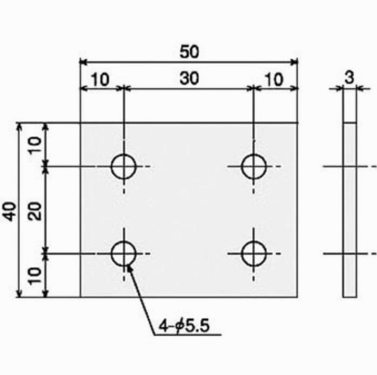

# Drawing To NX

Convert 2D engineering drawings into Siemens NX 3D models using Python, OpenCV, and NXOpen.

## Pipeline

2D Drawing → OpenCV Image Processing → Geometric Recognition → JSON → NXOpen → 3D NX Model

## Current Progress

- [x] Set up Python and OpenCV environment
- [x] Load engineering drawing image
- [x] Convert image to grayscale
- [x] Apply binary threshold preprocessing
- [ ] Detect outer profile
- [ ] Detect circular holes
- [ ] Convert pixel geometry to real dimensions
- [ ] Export geometry to JSON
- [ ] Generate 3D geometry in Siemens NX

## Input image
The first prototype uses a simple rectangular plate with four circular holes.

## Output images
| Gray | Binary |
|------------|------------|
|  |  |
