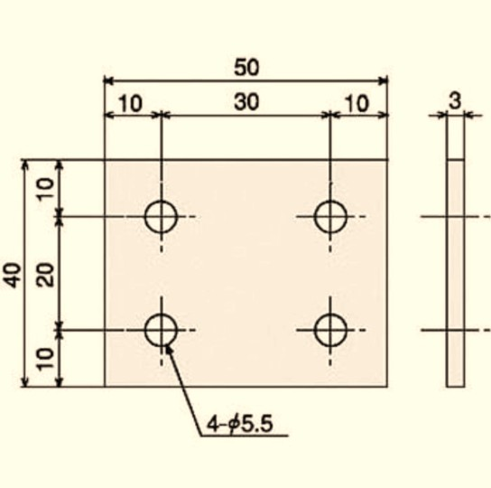
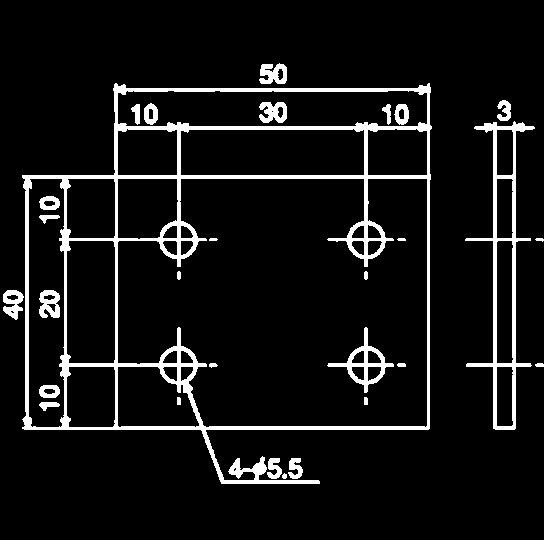
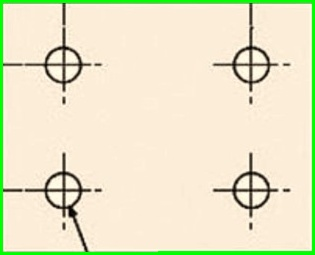
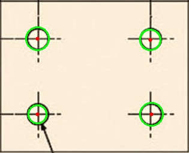

# Drawing To NX

Convert 2D engineering drawings into Siemens NX 3D models using Python, OpenCV, and NXOpen.

## Pipeline

2D Drawing → OpenCV Image Processing → Geometric Recognition → JSON → NXOpen → 3D NX Model

## Current Progress

- [x] Set up Python and OpenCV environment
- [x] Load engineering drawing image
- [x] Convert image to grayscale
- [x] Apply binary threshold preprocessing
- [x] Detect outer profile
- [x] Detect circular holes
- [x] Convert pixel geometry to real dimensions
- [x] Export geometry to JSON
- [ ] Generate 3D geometry in Siemens NX

## Input image
The first prototype uses a simple rectangular plate with four circular holes.


## Output images
| Gray | Binary |
|------------|------------|
|  |  |

## Plate detection


## Hole detection


Green: Perimeter of the circles / Red: Center of the circles

## Dimension data extraction
Convert pixel geometry to real dimensions using OCR (Optical Character Recognition)
```text
Horizontal OCR result:
Text: 10 x: 394 y: 312 confidence: 96
Text: 30 x: 779 y: 306 confidence: 96
Text: 10 x: 1147 y: 312 confidence: 96
Text: 5.5 x: 801 y: 1375 confidence: 90

Vertical OCR Result:
Text: 40 x: 392 y: 9 confidence: 97
Text: 10 x: 117 y: 119 confidence: 96
Text: 20 x: 396 y: 119 confidence: 96
Text: 10 x: 681 y: 119 confidence: 96
```

## Export to JSON
```text
{
    "units": "mm",
    "plate": {
        "width": 50.0,
        "height": 40.0,
        "thickness": 3.0
    },
    "holes": [
        {
            "x": 10.0,
            "y": 10.0,
            "diameter": 5.5
        },
        {
            "x": 40.0,
            "y": 10.0,
            "diameter": 5.5
        },
        {
            "x": 10.0,
            "y": 30.0,
            "diameter": 5.5
        },
        {
            "x": 40.0,
            "y": 30.0,
            "diameter": 5.5
        }
    ]
}
```
